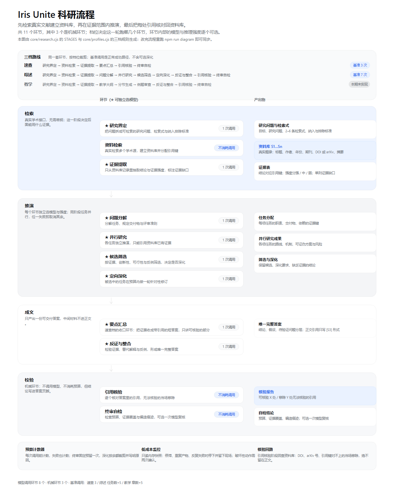

# Iris Unite

[](https://github.com/L0Y8T/iris-unite/actions/workflows/ci.yml)

一门面向**可核验科研**的桌面工作台：先检索真实文献建立资料库，再让多个模型在证据范围内推演、互相审查，最后把每一处引用逐个核对回资料库——指不回去的引用会被当场移除，而不是留在答案里充当真实出处。



> **English summary.** Iris Unite is a desktop workbench for *verifiable* research. It retrieves real literature first
> (OpenAlex / Crossref / arXiv / PubMed, no API key needed), assigns every record a citation key, and forces the model
> to cite only from that library. After drafting, a mechanical pass resolves every citation marker back to its record;
> unresolved ones are removed instead of being left in as fake sources. Experiments run on controlled Python templates,
> every number must bind to a real run manifest, and experiment markers are checked the same way.
> Windows is the only platform verified on real hardware so far — see the platform matrix below before installing on
> macOS or Linux.

## 下载

安装包在 [Releases](https://github.com/L0Y8T/iris-unite/releases/latest)。每行前面写的是这个包适配的系统版本：

| 适配系统版本 | 下载 | 说明 |
| --- | --- | --- |
| Windows 10 或更高（64 位） | [`iris-unite-0.6.0-win-x64-setup.exe`](https://github.com/L0Y8T/iris-unite/releases/download/v0.6.0/iris-unite-0.6.0-win-x64-setup.exe) | NSIS 安装器，可选安装目录 |
| Windows 10 或更高（64 位） | [`iris-unite-0.6.0-win-x64-portable.exe`](https://github.com/L0Y8T/iris-unite/releases/download/v0.6.0/iris-unite-0.6.0-win-x64-portable.exe) | 免安装，双击即用 |
| macOS 13 Ventura 或更高（Apple Silicon） | [`iris-unite-0.6.0-mac-arm64.dmg`](https://github.com/L0Y8T/iris-unite/releases/download/v0.6.0/iris-unite-0.6.0-mac-arm64.dmg) | M 系列芯片 |
| macOS 13 Ventura 或更高（Intel） | [`iris-unite-0.6.0-mac-x64.dmg`](https://github.com/L0Y8T/iris-unite/releases/download/v0.6.0/iris-unite-0.6.0-mac-x64.dmg) | Intel 芯片 |
| 64 位 Linux（需 libgtk-3 / libsecret 等运行库） | [`iris-unite-0.6.0-linux-x86_64.AppImage`](https://github.com/L0Y8T/iris-unite/releases/download/v0.6.0/iris-unite-0.6.0-linux-x86_64.AppImage) | 免安装，需先 `chmod +x` |
| 64 位 Debian / Ubuntu | [`iris-unite_0.6.0_amd64.deb`](https://github.com/L0Y8T/iris-unite/releases/download/v0.6.0/iris-unite_0.6.0_amd64.deb) | 装完有菜单项，依赖由包管理器检查 |

产物未签名，首次安装会被系统拦一次——点哪个按钮见下方[「未签名产物的系统拦截」](#未签名产物的系统拦截)。

Windows 与 macOS 的下限来自 Electron 44 自身的支持范围：`macOS 12 已不再支持，需要 Ventura 或更高`、`Electron 23 起只支持 Windows 10+`（见 [Electron breaking changes](https://www.electronjs.org/docs/latest/breaking-changes)）。Linux 这一栏没写发行版版本号：Electron 只要求 64 位，能不能装上取决于发行版有没有 libgtk-3 / libsecret 这些运行库，deb 会在安装时替你检查。

## 它解决什么问题

大模型写科研答案时最容易出的两个毛病是**编造文献**和**把假设写成事实**。光在提示词里写"不许编造"没用，因为没有任何东西去检查它。

这个工具的做法是把检查变成机械环节：

1. **先检索，后写作**。研究界定阶段产出检索式，检索阶段真的去 OpenAlex / Crossref / arXiv / PubMed 取题录（不需要任何 API Key），建立本轮资料库，每条记录分配一个引用键 `S1`、`S2`…
2. **证据提取只看资料库**。模型被要求只从资料库里抽结论，并标明证据强度与缺口；它引用了不存在的键，会被管线直接剔除。
3. **答案里的引用必须落地**。生成结束后，引用核验环节逐个比对：`[S3]` 必须能指回资料库第 3 条，DOI 和 arXiv 号必须精确命中；对不上的一律替换成「未核实引用」，并在界面上标出来。
4. **终审自检**。检查预算、证据覆盖、缺乏证据的结论；还可以额外挂一次模型复核（可选，默认关闭以省调用）。

资料库为空时，程序会明确告诉你"本轮没有检索到文献，引用无法核验"，而不是假装有证据。

## 三档 Profile，每个环节都能换模型

先选档位，档位决定这一轮跑哪些环节、要几次调用；环节内部的模型与推理强度逐个可选，包括过去写死的统筹与终审。

| 档位 | 产出 | 环节顺序 | 基准调用 |
| --- | --- | --- | --- |
| **速查** | 带引用的事实答案 | 界定 → 检索 → 证据 → 要点汇总 | 3 次 |
| **综述** | 完整科研答案 | 界定 → 检索 → 证据 → 问题分解 → 并行研究 → 候选筛选 →（定向深化）→ 反证与整合 | 任务数 + 5 次 |
| **教学** | 分章讲解 | 界定 →（检索 → 证据）→ 大纲 → 分节 → 例题 → 整合 | 章数 + 5 次（**本期未实现**，界面上明确标出并禁用） |

环节与是否消耗调用：

| 环节 | 是否消耗调用 |
| --- | --- |
| 研究界定 | 1 次 |
| 资料检索 | 0（本地，直接打学术接口） |
| 证据提取 | 1 次 |
| 要点汇总 | 1 次（速查档收口） |
| 问题分解 | 1 次 |
| 并行研究 | 每项任务 1 次（1–4 项） |
| 候选筛选 | 1 次 |
| 定向深化 | 每项被选中的任务 1 次（预算不足会跳过并说明） |
| 反证与整合 | 1 次 |
| 引用核验 | 0（机械核对） |
| 终审自检 | 0（机械自检；可选加 1 次模型复核） |

调用预算由账本管理：占位在请求发出前完成，失败、截断、取消的请求照样计数，并为收口环节保留额度；可选深化只有在「剩余 − 保留」还够时才启动。配置面板里的**计划预览**会先把这一轮的环节数、基准调用、上限与检索覆盖算给你看，点保存之前就知道要花几次调用。

## 实验执行（能真跑，且每个数字都能核对）

侧栏「实验执行」里选模板、填参数、点运行，程序会：

1. 按模板声明的依赖建一个**独立 venv**（不碰系统 Python），按指纹复用；
2. 在独立运行目录里起进程，日志逐行回传，超时或取消会**杀掉整棵进程树**；
3. 结束时收集产物、算 SHA-256，写一份**运行记录**（manifest）；
4. 只有「退出码 0 + 指标可解析 + 产物齐全」才算成功，否则在界面上写明原因。

| 模板 | 状态 | 说明 |
| --- | --- | --- |
| 执行环境自检 | 可用 | 只依赖 numpy，几秒完成，用来确认执行链路（也能验证超时与取消） |
| 表格分类基线 | 可用 | sklearn 自带数据集，真实准确率 + macro-F1 + 混淆矩阵图 |
| 小型 CNN 训练 | 未实现 | 需要 PyTorch 与 MNIST 下载策略，界面上禁用、运行期拒绝 |

**受控的边界**：只能跑随程序分发的模板脚本，你或模型只能填白名单参数（数据集、模型、种子、超时等），不能提交任意代码。原因是当前没有可用的隔离层——没有 WSL 发行版、也没有容器运行时，模型现写的代码会以你的用户权限直接跑在本机磁盘上。自由代码执行要等 WSL2 容器（`docs/research-mode-design.md` §19 的 E2）。

**实验数字必须能核对**：科研模式的最终答案里，实验数字必须指回本对话已完成的运行记录。指不回的当场标成 `〔未核对：88.8%〕`，并在终审自检里记为未通过；答案页脚显示「实验数字已核对 N 项」或「〔未核对〕实验数字 M 处」。执行另有独立预算（本对话 20 次 / 今日 50 次 / 今日 7200 秒），不占模型调用预算。

实测（本机 32 核 / RTX 4090 Laptop）：digits 数据集随机森林，测试集准确率 **0.9639**、macro-F1 **0.9634**，训练 0.518 秒；从建环境到出结果共 35.2 秒。门禁实测：真实数字 `11.200641 [E1]` 通过并绑定 1 处，编造数字 `999.999999 [E1]` 被标为未核对。

## 任意模型通道

设置 →「其他 AI 模型」里内置服务商预设，也可以连任何遵循 **OpenAI Chat Completions** 或 **Anthropic Messages** 的服务：

OpenAI、Anthropic、Google Gemini、DeepSeek、OpenRouter、Moonshot、智谱 GLM、阿里通义、硅基流动、Groq、Mistral、Ollama、LM Studio、自建 vLLM……以及自定义地址。

- 选预设会自动填好 Base URL、接口格式与推理参数形态
- 「拉取列表」可以直接从服务端读取可用模型 ID，不用背
- 密钥用 Windows DPAPI（Electron safeStorage）在本机加密，界面只显示"密钥已保存"，也不回传给渲染层
- 换地址必须重新填密钥，避免把旧密钥发到新端点

另外内置两条本机通道：DeepSeek 官方接口，以及通过本机已登录的 Codex CLI 调用的 GPT 系列。

## 低成本运行监控

长时间跑的任务最怕两件事：卡住没人知道，或者在重复劳动里烧钱。监控模块每 30 秒读一次内存里的运行快照（不发请求、不调用模型），只在值得注意时动作：

- **停滞**：长时间没有任何新内容 → 停下本轮并把现场（阶段、调用数、产物统计）写进记录
- **重复**：同一阶段出现内容完全相同的产物 → 判定重复劳动
- **反复失败**：同一条错误连续出现 → 中止
- **预算**：接近上限时提醒，为终审保留调用

破坏性动作要求连续两次确认才执行，避免瞬时抖动误杀。

## 一键导出结果

一轮科研跑完，答案下方和工具栏各有一个「导出结果」：点一下就把这一轮的全部产出落成一份 Markdown，直接进下载目录，不弹对话框（按住 Shift 才是另存为）。

导出的是完整研究包，不是一段正文：

| 内容 | 说明 |
| --- | --- |
| 结论 | 核验后的答案正文 |
| 核验 | 文献引用与实验数字分别给结论，未核验的逐条列出 |
| 实验运行 | E 编号表 + 逐次运行记录：参数、指标、产物 SHA-256、环境指纹、runId |
| 研究界定 / 证据 / 任务分解 / 候选筛选 | 各阶段结构化产出原文 |
| 资料库 | 每条记录的键、来源、年份、标题、标识 |
| 终审自检 | 检查项表格与模型复核结论 |
| 阶段产出记录 | 每阶段状态、模型、字数、耗时 |

两条规则写在代码里：**编号与答案对齐**（只给成功运行编号，按开始时间排，和正文里的 `[E1]` 同一个命名空间）；**不写本机路径与密钥**（环境指纹只留版本号，产物只给文件名与哈希前缀）。同名文件自动加 `-2`，第二次导出不会覆盖上一次。

## 接着跑实验

一轮研究给出的「验证实验设计与优先级」是给你的下一步，不是这一轮的成品。看完觉得方向对，答案下方有「执行实验」：它沿用这一轮的研究界定、证据、任务分解、资料库与推演成果，**只跑实验（设计 → 真训 → 分析 → 记录）和最后的整合**，不会把前面整套重来。

| | 完整研究一轮 | 接着跑实验 |
| --- | --- | --- |
| 模型调用 | 10 次以上 | 3 次左右 |
| 前序环节 | 界定 → 检索 → 证据 → 分解 → 并行 → 筛选 | 全部沿用，一次都不跑 |
| 结论 | — | 原来的结论不被替换，实验数字补进新一轮答案 |

跑过实验的轮次不会再出现这个按钮；承接关系只作用于这一轮，不会改掉对话的研究配置。

**必须点名执行哪一个方案。** 答案里常常列着好几个候选方向，程序不会自己挑一个去跑：

- 点「执行实验」只打开「执行哪一个实验方案」对话框，不出请求；对话框会先把答案里「实验建议」段落下的编号条目列成候选，点一下填进文本框；
- 不写方案就确认 → 被挡下，一个请求都不发；
- 只有写下了/选中了某一条，才照着它设计实验（`requestedPlan`），模型不得换成别的方向；
- 也可以直接在输入框写 `执行实验：<方案>`，同样只跑实验与整合。

## 花费估算

回复底部的 `15,000 tokens` 旁边会多一个 `≈¥0.0480`：在「连接设置 → 花费估算」里填每个通道的输入价 / 输出价（每百万 token）、选好币种就行。运行中的状态条也会随每次调用往上走。

不内置任何价目表——同一模型在不同套餐、不同时段、不同地域的单价都不一样，写死只会算出一份错账单。所以：

- 没填单价时显示「未设单价」，不给猜出来的数字；
- 一轮里用到多个通道时，用量按通道分开记账，货币不同分别合计（不把人民币和美元加在一起），没设单价的通道单独点名。

## 不绑定任何一家厂商

只对一个第三方模型也完全可用：装一个 API Key、加一个连接，科研流程照样跑，不依赖 Codex。

## 平台支持

| 平台 | 状态 | 说明 |
| --- | --- | --- |
| Windows x64 | **真机验证过** | NSIS 安装器与免安装版；实验执行走本机 Python |
| macOS（Apple Silicon / Intel） | 代码已适配，**未真机验证** | 保留系统红绿灯、⌘ 快捷键、`.icns` 图标；未签名未公证 |
| Linux x64 | 代码已适配，**未真机验证** | AppImage 与 deb；训练进程按 POSIX 进程组清理 |

**「已适配」不等于「跑过」**：指代码里按平台的分支都写了，并且有单测覆盖三个平台的分支（`tests/platform.test.cjs`）。
这台开发机只有 Windows——macOS 与 Linux 的实际体验由 CI 的 `macos-latest` / `ubuntu-latest` 任务与使用者反馈来验证。
第一次在 mac 或 Linux 上打开时如果遇到问题，那就是真实缺口，请开 issue。

### 运行要求

- Node.js 20+ 与 npm（源码运行 / 开发）
- 想用 GPT 通道：本机安装并登录 Codex CLI（可选增强，缺了不影响其他功能）
- 想用 DeepSeek 内置通道：DeepSeek API Key
- **跑实验**：本机 Python 3.8+（建议 3.10+）。程序按 `IRIS_PYTHON` → `python3` → `python`（Windows 还有 `py -3`）的顺序找解释器；
  找不到时只有实验不可用，其余功能照常，错误信息里会列出试过的每一个候选

### 各平台差异

| 项目 | Windows | macOS | Linux |
| --- | --- | --- | --- |
| 窗口 | 自绘无边框标题栏 | 系统红绿灯（hiddenInset） | 自绘无边框标题栏 |
| 快捷键 | `Ctrl+N` / `Ctrl+B` | `⌘N` / `⌘B` | `Ctrl+N` / `Ctrl+B` |
| 关掉全部窗口 | 退出程序 | 留在 Dock，点图标重开 | 退出程序 |
| 密钥存储 | DPAPI（safeStorage） | Keychain | 需要 libsecret（deb 已声明依赖） |
| 训练进程清理 | `taskkill /T /F` | POSIX 进程组 SIGKILL | POSIX 进程组 SIGKILL |
| 字体回退 | 微软雅黑 | PingFang | Noto Sans CJK / 思源黑体 |

### 未签名产物的系统拦截

三个平台的产物都**没有代码签名**。装一次要走一步批准，之后不再拦：

**Windows** — SmartScreen 弹「Windows protected your PC」，点「更多信息 → 仍要运行」。
注意：Windows 11 开着「智能应用控制（Smart App Control）」时，无信誉的未签名程序会被直接拦死、没有「仍要运行」按钮；
受企业策略管理的设备同理。这类环境下只能签名或改用商店分发。

**macOS** — Gatekeeper 弹「无法验证开发者 / 无法验证是否包含恶意软件」，点「取消」，然后：

1. 苹果菜单 → **系统设置** → **隐私与安全性**
2. 滚到「安全性」区，会看到刚被拦下的 Iris Unite → 点 **仍要打开**
3. Touch ID / 密码确认 → 再点「打开」

macOS 15 之后这是主路径；老的「右键点图标 → 打开」不一定有效。
终端里也可以一步到位：`xattr -dr com.apple.quarantine "/Applications/Iris Unite.app"`。

**Linux** — AppImage 需要先 `chmod +x`；deb 用 `sudo apt install ./iris-unite_*.deb`。

要彻底消除这些提示需要购买商业证书。本仓库的产物未签名，签名配置位留在打包配置里，供有证书时启用。

## 开发与构建

```bash
git clone https://github.com/L0Y8T/iris-unite.git
cd iris-unite
npm ci                   # 装依赖（Electron 会被下载，约 200 MB）
npm test                 # 离线单测，不花钱
npm run test:frontend    # 界面与可访问性回归（Linux 需要 xvfb-run）

# 打包：三种产物
npm run dist:win         # NSIS 安装器 + 免安装 exe
npm run dist:mac         # dmg + zip（x64 / arm64）
npm run dist:linux       # AppImage + deb
npm run icons            # 从 assets/iris.png 重新生成 iris.icns
```

源码直接跑：`npm start`。旧的 electron-packager 链路（`npm run package`）仍在，产物出在 `build/`。

```powershell
npm ci
npm start                          # 开发运行，数据在 .local-data
npm run diagram                    # 重新生成科研架构图
npm run package                    # 打包到 build\IrisUnite-win32-x64

npm test                           # 211 项逻辑测试，不联网、不调用模型
npm run test:all                   # 全部 20 项验收，约 10–15 分钟（含真实模型调用）
npm run test:all -- --skip-live    # 跳过真实模型调用，约 4 分钟
npm run test:all -- --only=retry,exec-gate
```

单项也可以单独跑，完整清单见 [`docs/verification.md`](docs/verification.md)（每项证明什么、是否消耗额度、约耗时）。

```powershell
node tests/dsh-visual-check.cjs     # 界面与可访问性（逐界面截图 + 明暗 axe）
node tests/retry-check.cjs          # 重新生成与旧答案保留（本地假模型服务）
node tests/research-run-check.cjs   # 科研草稿→核验→发布
node tests/research-ui-check.cjs    # 档位选择与计划预览
node tests/plan-ipc-check.cjs       # 计划/档位接口
node tests/exec-ui-check.cjs        # 实验面板（会真跑一次 Python）
node tests/exec-gate-check.cjs      # 实验→答案→数字门禁
node tests/history-check.cjs        # 本机 Codex/DSH 历史读取
node tests/live-check.cjs           # 模型通道连通（真实调用 2 次）
node tests/packaged-check.cjs       # 打包产物验收（DUET_VERIFY_EXE 指向要验的 exe）
npm run test:ui                     # 应用内建 UI 冒烟（真实双模型协作 8 次调用）
npm run test:frontend               # 应用内建前端验收
```

## 数据存放

| 位置 | 用途 |
| --- | --- |
| `%APPDATA%\IrisUnite` | 正式版的对话、设置与资料库 |
| `.local-data` | 开发运行（已 gitignore） |
| `.test-data` / `.verification-profile` | 测试与验收的隔离数据 |

从旧版本升级时，如果程序目录里还留着 `Iris-data`，首次启动会把它复制到新位置并在新目录写一份 `migrated-from.json` 说明来源，原目录不动。

## 已知限制

- **执行是受控的**：只能跑内置模板脚本，不能自由写代码（需要 WSL2 容器隔离，本期未做）。
- **教学档本期未实现**：配置与计划预览可看，但在界面上禁用，运行期也会明确拒绝，不是「悄悄跑一半再失败」。
- **引用核验是机械比对，不是语义判断**：DOI / arXiv 号 / 引用键能保证"指得回本轮真实检索到的记录"，但不能保证那篇文献本身支持该结论。证据是否够支撑结论仍要人判。
- **作者-年份式引用无法机械核验**，只会被统计成可疑项，不会被自动清除。
- **检索只覆盖有公开接口的学术源**，不包含付费数据库、专利库与全文 PDF 解析；摘要是接口返回的摘要，不是全文。
- DeepSeek 内置通道读 `.zstd` 压缩历史依赖本机已安装的 DSH Desktop，缺失时该部分历史读不到（不影响其他功能）。
- **产物未签名、无自动更新**：Windows 有 NSIS 安装器与免安装版，macOS / Linux 由 CI 产出；但安装时会有系统警告（见上文「未签名产物的系统拦截」）。
- **实验只能跑内置模板**：模型不能自由写 Python，只能从内置模板（表格分类基线、执行环境自检）里选参数；没有模板覆盖的问题跑不了实验。

## 许可与署名

代码以 [MIT](LICENSE) 许可发布。

应用图标（鸢尾花纹样）改造自 [game-icons.net](https://game-icons.net) 的 `fleur-de-lys`（作者 Delapouite），许可 **CC BY 3.0**，改造说明见 [LICENSE](LICENSE) 与打包内的 `renderer/vendor/licenses/iris-icon.txt`。
界面图标来自 [Tabler Icons](https://tabler.io/icons)（MIT），Markdown 渲染使用 [marked](https://github.com/markedjs/marked)（MIT），HTML 净化使用 [DOMPurify](https://github.com/cure53/DOMPurify)（Apache-2.0 / MPL-2.0 双许可）。

## 文档

- [科研模式设计（汇总）](docs/research-mode-design.md)：档位设计、本期范围、模块改造、后续阶段与边界
- [科研流程架构图](docs/research-architecture.svg)（由 `npm run diagram` 从代码生成）
- [发版清单](docs/release.md)：改哪两处版本号、跑哪些检查、三平台产物怎么出、发布说明必须写什么
- [跨平台改造方案](docs/portability-plan.md)：三平台差异、决策结果与仍未做的部分
- [验收清单](docs/verification.md)：每一项检查证明什么、花不花钱、跑多久（一键跑就是 `npm run test:all`）
- [0.6 变更说明](docs/CHANGELOG-0.6.md)
- [0.5 完整交接文档](docs/handoff-0.5.md)（历史版本，结构与实现描述对应 0.5.0）
